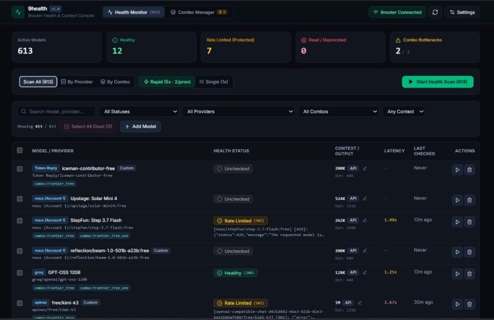

# 9health (9router Health Dashboard)

[English](./README.md) | **Bahasa Indonesia**

Aplikasi **CLI + web dashboard (dark-mode)** independen (*companion app*) untuk **[9router](https://github.com/decolua/9router)**.  
Dirancang untuk pengguna aktif 9router dan *free-tier hunter* agar bisa mengaudit kesehatan ratusan model AI secara cepat, membersihkan model mati tanpa merusak *Combo*, mengelola seluruh provider secara rapi, serta mendeteksi *bottleneck* **Effective Context Window** secara *real-time*.



---

## Instalasi & Menjalankan (1 Perintah)

> **Prasyarat:** Node.js `>= 20` dan layanan `9router` lokal yang sedang aktif (default `http://127.0.0.1:20128`) — atau langsung coba offline menggunakan **Demo Sandbox Mode** (`9health --demo`).

### Opsi 1: Install global dari npm *(setelah dipublikasikan)*
```bash
npm install -g 9health
9health
```
Atau jalankan langsung tanpa install:
```bash
npx 9health
```

### Opsi 2: Install global langsung dari GitHub
```bash
npm install -g github:revanzk/9health
9health
```

### Opsi 3: Build lokal & global CLI link (dari source)
```bash
git clone https://github.com/revanzk/9health.git
cd 9health
pnpm install
pnpm run build
npm link
9health
```

Cukup ketik `9health` di terminal — local proxy + dashboard langsung berjalan di **`http://127.0.0.1:3099`** dan otomatis membuka browser. Seluruh data lokal (pengaturan, hasil scan terakhir, *Last Checked*, *Manual Override* context window, dan cache metadata registry) tersimpan aman di **`~/.9health/store.json`**.

### Opsi CLI
| Flag | Deskripsi | Default |
| :--- | :--- | :--- |
| `-p, --port <number>` | Port untuk menjalankan 9health | `3099` |
| `--host <address>` | Alamat host/interface untuk bind | `127.0.0.1` |
| `--router <url>` | Base URL 9router lokal | `http://127.0.0.1:20128` |
| `--data-dir <path>` | Folder kustom untuk menyimpan state lokal | `~/.9health` |
| `--demo` | Langsung jalankan dalam Demo Sandbox Mode | `false` |
| `--no-open` | Jangan buka browser secara otomatis | `false` |
| `-v, --version` | Tampilkan versi 9health | — |
| `-h, --help` | Tampilkan bantuan CLI | — |

---

## Menghubungkan ke 9router

1. Nyalakan `9router` (port default `20128`).
2. Jalankan `9health`. Aplikasi akan mengecek `/api/auth/status` secara aman (~35ms) tanpa memicu *login rate limiter* 9router.
3. Jika dashboard 9router-mu memakai password kustom, masukkan password langsung pada **banner kuning di bagian atas** (atau di menu **Settings**) lalu klik **Unlock Combos** untuk memuat daftar lengkap anggota Combo, seluruh provider (termasuk OAuth & yang dinonaktifkan), serta fitur edit/hapus.
4. Belum menyalakan 9router? Klik **Launch Demo Sandbox** (atau jalankan `9health --demo`) untuk mencoba semua fitur secara offline.

---

## Fitur Utama (v1.0)

### 1. Health Scanner Real-Time & Rollback Status `Pending`
* **Filter Dinamis & Tersinkronisasi:** Memilih **Scan All**, **By Provider** (bisa multi-provider), **By Combo**, atau mengubah filter tabel (`Search`, `Status`, `Min Context`) langsung menyaring daftar model secara *real-time* — dan tombol **Scan Filtered** akan memindai persis model yang sedang tampil.
* **Mode Scan & Batas Konkurensi Per-Provider:**
  * **Rapid Scan:** Maksimal **5 model paralel secara global** dengan batas **1–2 paralel per provider** + jeda *pacing* (`ms`) agar tidak memicu blokir/rate limit `429` massal.
  * **Single Scan:** Sekuensial (`1x`) paling aman untuk provider dengan kuota ketat.
* **Status `Pending` Real-Time & Aman Di-Cancel:** Saat scan dimulai, seluruh model target langsung berubah ke status **`Pending`** (ikon spinner) dan diperbarui satu per satu via **SSE**. Jika tombol **`Stop Scan`** ditekan di tengah jalan, hasil model yang sudah selesai tetap tersimpan, sementara semua model yang masih **`Pending`** **otomatis kembali ke state awalnya**.
* **Direct Model Probe & Kompatibilitas Model Reasoning:** Mengirim *lightweight prompt* (`max_tokens: 1`) langsung ke slug `provider/model` (bukan nama Combo, sehingga tidak memicu *auto-fallback* palsu), serta otomatis mencoba ulang dengan `max_completion_tokens` jika model *reasoning/thinking* menolak `max_tokens: 1`.
* **Klasifikasi 6 Status Error Granular** *(kombinasi HTTP status + inspeksi isi JSON error body)*:
  1. **Healthy (`200`)** — Respons valid (termasuk respons *reasoning-only*).
  2. **Rate Limited (`429` / `503`)** — Sedang sibuk atau kuota RPM sementara habis.
  3. **Auth / Quota (`401` / `402` / `403`)** — API Key tidak valid atau kredit habis.
  4. **Dead / Deprecated (`404` / `410` / `400` invalid model)** — Model sudah dihapus atau berubah ID di provider.
  5. **Transient Error (`5xx` / `400` parameter error)** — Gangguan server sementara atau ketidakcocokan parameter request.
  6. **Timeout / Network** — Melewati batas waktu tunggu (default `15 detik`, dapat diatur).

### 2. Deteksi Lengkap Semua Provider (Nol UUID Random)
* **Semua Provider Terhubung Masuk:** Menampilkan seluruh provider yang terhubung di 9router — baik yang **Aktif**, **Dinonaktifkan (`Off`)**, **OAuth (`OAuth`)**, **API Key**, maupun **Custom OpenAI/Anthropic-Compatible**.
* **Nama Asli Provider Custom:** Membaca `/api/provider-nodes` dan `/api/providers` untuk mengubah ID internal `openai-compatible-chat-<uuid>` menjadi nama asli yang kamu buat di 9router, sekaligus memetakan alias bawaan 9router (`cline → cl`, `kiro → kr`, `cloudflare-ai → cf`, `kilo-gateway → kgw`, `bazaarlink → bzl`) tanpa duplikasi.

### 3. Pembersihan Model Aman & Cascade Impact
* **Smart Safety Guard:** Pintasan **"Select All Dead"** hanya mencentang model berstatus **`Dead / Deprecated`** — model berstatus *Rate Limited (`429`)*, *Transient Error*, dan *Timeout* terlindungi dan tidak ikut tercentang otomatis.
* **Cascade Impact & Quick Swap:** Sebelum menghapus model, 9health memeriksa seluruh Combo yang terdampak dan menyediakan opsi:
  * **Quick Swap:** Mengganti model mati di dalam Combo langsung dengan model *Healthy* (diurutkan dari latensi tercepat & context window besar).
  * **Remove & Clean from Combo:** Menghapus model sekaligus membersihkannya dari Combo terkait.
  * **Proteksi Combo Tunggal:** Memberi peringatan khusus jika model yang dihapus adalah satu-satunya model tersisa di dalam Combo (meminta **Swap**, **Hapus Model + Combo**, atau **Batal**).
* **Tambah Model Manual:** Menambahkan model kustom langsung ke 9router dari dashboard beserta spesifikasi *Context Window* & *Max Output*.

### 4. Combo Manager & Deteksi Context Window Bottleneck
* **Editor Urutan Prioritas Fallback:** Membuat, mengubah nama, mengedit anggota, menghapus Combo, serta mengatur urutan *fallback* via **drag-and-drop** atau tombol panah naik/turun — langsung tersinkronisasi ke 9router.
* **Effective Context Window:** Menghitung otomatis kapasitas konteks efektif tiap Combo berdasarkan **nilai terkecil (*Lowest Common Denominator*)** dari seluruh model di dalamnya.
* **Bottleneck Warning Badge:** Menyoroti otomatis model yang kapasitas konteksnya **`≤ 50%`** (dapat dikonfigurasi) dari model terbesar di Combo yang sama.
* **Hirarki Metadata 3 Lapis:** Menyelesaikan info *Context Window* & *Max Output* lewat urutan **`Manual Override` → `API 9router` → `Metadata Registry Lokal`** (katalog lokal + tombol sinkronisasi katalog OpenRouter 1 klik), disertai peringatan **`Unknown`** jika data belum tersedia.

---

## Arsitektur & Keamanan

* **Thin Local Express Proxy (`server/`):** Menghindari masalah CORS browser saat mengakses API lokal 9router, mengelola cookie sesi dashboard 9router di memori, serta menjalankan pemindaian konkuren dengan *SSE streaming*.
* **Keamanan Kredensial:** API Key provider tetap sepenuhnya dikelola di 9router dan tidak pernah disimpan di *browser storage*.
* **Penyimpanan Lokal Persisten:** `~/.9health/store.json` (penulisan atomik *temp-file + rename*) menyimpan hasil scan, *Last Checked*, *Manual Override*, pengaturan, dan cache registry secara permanen lintas sesi dan upgrade.

---

## Pengembangan, Pengujian & Launcher

```bash
# Mode development hot-reload (Express API :3099 + Vite :5173)
pnpm run dev

# Jalankan seluruh unit, CLI, dan API integration test (25 test)
pnpm test

# Type-check dan build server CLI (dist-server/) + frontend (dist/)
pnpm run build

# Publish paket ke npm (setelah `npm login`)
npm publish
```

### Unified Launchers & Docker
* **Windows:** Jalankan `start-9health.bat` (otomatis mengecek/menjalankan `9router` di port `20128`, lalu membuka `9health`).
* **macOS / Linux:** Jalankan `./start-9health.sh`.
* **Docker Compose:**
  ```bash
  docker compose up --build
  ```
  Lalu ubah **9router Base URL** ke `http://host.docker.internal:20128` di menu Settings.

---

## Dokumentasi
* Dokumen PRD: [prd_9health_9router_health_dashboard.md](./prd_9health_9router_health_dashboard.md)
