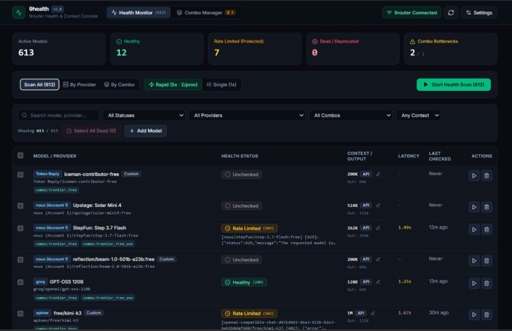

# 9health (9router Health Dashboard)

[](./LICENSE)
[](https://nodejs.org/)

**English** | [Bahasa Indonesia](./README.id.md)

A standalone **CLI + dark-mode web companion app** for **[9router](https://github.com/decolua/9router)**.  
Built for active AI router users and free-tier hunters to audit model health fast, eliminate silent Combo failures, manage providers cleanly, and spot **Effective Context Window** bottlenecks in real time.



---

## Quick Install & Run

> **Requirements:** Node.js `>= 20` and a local running instance of `9router` (default `http://127.0.0.1:20128`) — or launch offline in Demo Sandbox mode (`9health --demo`).

### Option 1: Install globally from npm *(once published)*
```bash
npm install -g 9health
9health
```
Or run directly without installing:
```bash
npx 9health
```

### Option 2: Install globally directly from GitHub
```bash
npm install -g github:revanzk/9health
9health
```

### Option 3: Local build & global CLI link (from source)
```bash
git clone https://github.com/revanzk/9health.git
cd 9health
pnpm install
pnpm run build
npm link
9health
```

Running `9health` starts the local proxy + dashboard on **`http://127.0.0.1:3099`** and automatically opens your browser. Local state (settings, scan results, `Last Checked`, manual context overrides, and cached metadata registry) is persisted in **`~/.9health/store.json`**.

### CLI Options
| Flag | Description | Default |
| :--- | :--- | :--- |
| `-p, --port <number>` | Port to run 9health on | `3099` |
| `--host <address>` | Host interface to bind | `127.0.0.1` |
| `--router <url>` | 9router base URL | `http://127.0.0.1:20128` |
| `--data-dir <path>` | Custom directory for local state storage | `~/.9health` |
| `--demo` | Launch directly in Demo Sandbox Mode | `false` |
| `--no-open` | Do not automatically open the browser | `false` |
| `-v, --version` | Print installed version | — |
| `-h, --help` | Show CLI help | — |

---

## Connecting to 9router

1. Start `9router` (default port `20128`).
2. Run `9health`. It probes `/api/auth/status` safely (~35ms) without triggering 9router's login rate limiter.
3. If your 9router dashboard uses a custom password, enter it directly in the **yellow Unlock banner** at the top of 9health (or in **Settings**) and click **Unlock Combos** to load full Combo member lists, OAuth/disabled provider catalogs, and editing actions.
4. No 9router running yet? Click **Launch Demo Sandbox** (or run `9health --demo`) to explore every feature offline.

---

## Features (v1.0)

### 1. Live Health Scanner & Safe `Pending` Rollback
* **Dynamic Synchronized Filtering:** Selecting **Scan All**, **By Provider** (multi-select), **By Combo**, or applying table filters (`Search`, `Status`, `Min Context`) dynamically updates the model list in real time — and **Scan Filtered** scans those exact visible models.
* **Scan Modes & Per-Provider Guardrails:**
  * **Rapid Scan:** Up to **5 concurrent models globally** with **per-provider concurrency (1–2)** and configurable pacing (`ms`) to avoid triggering provider `429` bursts.
  * **Single Scan:** Strictly sequential (`1x`) for strict free-tier limits.
* **Real-Time `Pending` State & Cancel Rollback:** Starting a scan marks all queued target models as **`Pending`** (live spinner) and streams results via **SSE** as each finishes. Clicking **`Stop Scan`** mid-scan keeps all completed results and **automatically restores every remaining `Pending` model back to its exact previous state**.
* **Direct Model Probing & Reasoning Compatibility:** Sends lightweight `max_tokens: 1` requests directly to each `provider/model` slug (never a combo name, preventing false-positive fallback) and automatically retries with `max_completion_tokens` when reasoning/thinking models reject `max_tokens: 1`.
* **Granular 6-Status Classification** *(HTTP status + JSON error body inspection)*:
  1. **Healthy (`200`)** — Valid completion or reasoning-only response.
  2. **Rate Limited (`429` / `503`)** — Temporarily busy / RPM exhausted.
  3. **Auth / Quota (`401` / `402` / `403`)** — Invalid key or exhausted credits.
  4. **Dead / Deprecated (`404` / `410` / `400` invalid model)** — Removed or renamed upstream.
  5. **Transient Error (`5xx` / `400` parameter error)** — Temporary upstream outage or parameter mismatch.
  6. **Timeout / Network** — Exceeded configurable timeout (default `15s`).

### 2. Complete Provider Discovery (Zero Random UUIDs)
* **All Connected Providers Included:** Loads **every connected provider** from 9router — including **Active**, **Disabled (`Off`)**, **OAuth (`OAuth`)**, **API Key**, and **Custom OpenAI/Anthropic-Compatible** providers.
* **Human-Readable Custom Provider Names:** Reads `/api/provider-nodes` and `/api/providers` to resolve internal IDs like `openai-compatible-chat-<uuid>` into the exact provider names you configured in 9router, while automatically mapping built-in 9router aliases (`cline → cl`, `kiro → kr`, `cloudflare-ai → cf`, `kilo-gateway → kgw`, `bazaarlink → bzl`) and deduplicating models.

### 3. Safe Model Cleanup & Cascade Impact
* **Smart Safety Guard:** The **"Select All Dead"** bulk action only selects **`Dead / Deprecated`** models — `Rate Limited (429)`, `Transient Error`, and `Timeout` models are never auto-checked.
* **Cascade Impact & Quick Swap:** Before deleting any model, 9health checks every affected Combo and lets you:
  * **Quick Swap:** Replace the dead model in-place with a `Healthy` model (sorted by fastest latency & context window).
  * **Remove & Clean from Combo:** Remove the model cleanly from affected Combos.
  * **Single-Model Combo Guard:** Explicitly warns when deleting the last remaining model of a Combo, requiring either **Swap**, **Delete Model + Delete Combo**, or **Cancel**.
* **Add Custom Models:** Add custom models directly to 9router from the dashboard with optional Context Window and Max Output specs.

### 4. Combo Manager & Context Window Awareness
* **Fallback Priority Editor:** Create, rename, edit, and delete Combos, and reorder fallback chains via **drag-and-drop** or **up/down arrows** — synced directly to 9router.
* **Effective Context Window:** Automatically calculates each Combo's safe effective context as the **minimum (`Lowest Common Denominator`)** across active member models.
* **Bottleneck Warning Badge:** Automatically highlights any model whose context window is **`≤ 50%`** (configurable) of the largest model in the same Combo.
* **3-Tier Metadata Fallback:** Resolves Context Window & Max Output via **`Manual Override` → `9router API` → `Local Metadata Registry`** (curated catalog + 1-click OpenRouter catalog sync), with explicit **`Unknown`** warnings when metadata is missing.

---

## Architecture & Security

* **Thin Local Express Proxy (`server/`):** Eliminates browser CORS issues when talking to local 9router endpoints, manages 9router dashboard session cookies in-memory, and runs concurrent health scans with SSE streaming.
* **Credential Safety:** Provider API keys remain managed exclusively inside 9router and are never stored in browser storage.
* **Persistent Local Store:** `~/.9health/store.json` (atomic temp-file + rename writes) persists scan results, `Last Checked`, manual overrides, settings, and cached registry data across sessions and upgrades.

---

## Development, Testing & Launchers

```bash
# Hot-reload development (Express API :3099 + Vite :5173)
pnpm run dev

# Run unit, CLI, and end-to-end API integration tests (25 tests)
pnpm test

# Type-check and build both compiled CLI server (dist-server/) & frontend (dist/)
pnpm run build

# Publish package to npm (after `npm login`)
npm publish
```

### Unified Launchers & Docker
* **Windows:** Run `start-9health.bat` (auto-checks/starts `9router` on port `20128`, then opens `9health`).
* **macOS / Linux:** Run `./start-9health.sh`.
* **Docker Compose:**
  ```bash
  docker compose up --build
  ```
  Then set **9router Base URL** to `http://host.docker.internal:20128` in Settings.

---

## Documentation & License
* Product Requirements Document: [prd_9health_9router_health_dashboard.md](./prd_9health_9router_health_dashboard.md)
* Licensed under the [MIT License](./LICENSE) — Copyright © 2026 Revanzk.
